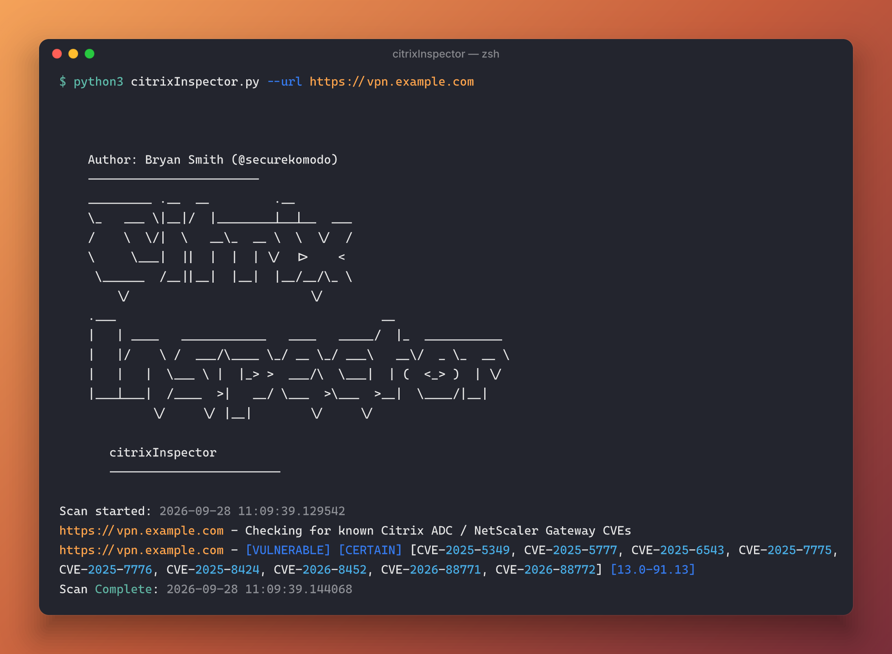

# citrixInspector

`citrixInspector.py` (formerly `cve_2023_3519_inspector.py`) is a Python-based, passive vulnerability
scanner for Citrix ADC / Citrix Gateway / NetScaler ADC / NetScaler Gateway appliances. It fingerprints
the exact firmware build of a target without authentication, and reports every known CVE that build is
vulnerable to.

> **⚠️ Beta:** Detection for the newer 2025/2026 CVEs (CitrixBleed 2/3, CVE-2026-8452,
> CVE-2026-88771/88772) is in **beta**. It relies on being able to fingerprint the exact firmware
> build via the GZIP-timestamp or vhash techniques; when neither works on a target, the scanner
> falls back to a much coarser, CVE-2023-3519-only heuristic and will not flag the newer CVEs at
> all (see the Checks Performed section below). Treat results for the newer CVEs as informational
> only.



*Output was run against a simulated test harness. Hostname is a placeholder only.*


### Recent Updates (2026)
- Renamed `cve_2023_3519_inspector.py` to `citrixInspector.py` to reflect its broader, multi-CVE scope.
- Added GZIP-timestamp version fingerprinting (`/vpn/js/rdx/core/lang/rdx_en.json.gz`) as the primary,
  most reliable unauthenticated build-identification technique, since the legacy `v=<hash>` static
  resource hash is "not always present anymore" on modern builds.
- Refreshed and greatly expanded the version-hash and GZIP-timestamp lookup tables, now covering builds
  from August 2018 through November 2025 (previously stopped at ~October 2023, with no 14.x coverage).
- Once an exact build is identified, the scanner now checks it against 10 CVEs instead of just
  CVE-2023-3519: CVE-2025-5349/5777 ("CitrixBleed 2"), CVE-2025-6543, CVE-2025-7775/7776/8424
  ("CitrixBleed 3"), CVE-2026-8452, and CVE-2026-88771/88772 (actively exploited, CISA KEV). See
  "CVE Coverage" below.
- Replaced the CVE-2023-3519 patch heuristic (guessing from the page's `Last-Modified` header) with a
  precise version-threshold comparison whenever an exact build is known, falling back to the original
  heuristic only when no build can be identified.
- Added functionality to parse the /vpn/pluginlist.xml file to determine more accurate checks if patched or vulnerable
- Added funcionality to optionally check for common web shell IOCs on the target server.
- Implemented logic on scanner to determine if target is verified patched. Thanks @UK_Daniel_Card & @DTCERT

## Installation

This script requires Python 3.6+ and the following Python packages:

- requests
- BeautifulSoup4
- argparse
- re
- logging
- warnings

To install the required packages, run:

```bash
git clone https://github.com/securekomodo/citrixInspector.git
cd citrixInspector
pip install -r requirements.txt
python citrixInspector.py -u <target_url>
```

## Usage
```
    Author: Bryan Smith (@securekomodo)
    ------------------------
    _________ .__  __         .__                              
    \_   ___ \|__|/  |________|__|__  ___                      
    /    \  \/|  \   __\_  __ \  \  \/  /                      
    \     \___|  ||  |  |  | \/  |>    <                       
     \______  /__||__|  |__|  |__/__/\_ \                      
        \/                         \/                      
    .___                                     __                
    |   | ____   ____________   ____   _____/  |_  ___________ 
    |   |/    \ /  ___/\____ \_/ __ \_/ ___\   __\/  _ \_  __ \
    |   |   |  \___ \ |  |_> >  ___/\  \___|  | (  <_> )  | \/
    |___|___|  /____  >|   __/ \___  >\___  >__|  \____/|__|   
             \/     \/ |__|        \/     \/                                

       citrixInspector
       ------------------------
       
usage: citrixInspector.py [-h] (-u URL | -f FILE) [--ioc-check] [-l LOG]

Fingerprint and check Citrix ADC / NetScaler ADC & Gateway for known CVEs.

optional arguments:
  -h, --help            show this help message and exit
  -u URL, --url URL     The URL of the Citrix/NetScaler Gateway to check.
  -f FILE, --file FILE  A file containing a list of URLs to check.
  --ioc-check           Slower. Performs IOC (Indicator of Compromise) check.
  -l LOG, --log LOG     Log file to write the output.

```

The `citrixInspector.py` script can either accept a single URL or a file with a list of URLs as input. It then performs a series of checks to determine the potential vulnerability of the given Citrix/NetScaler Gateways:

```bash
# Check a single URL
python citrixInspector.py --url https://example.com

# Check multiple URLs from a file
python citrixInspector.py --file urls.txt

# Check multiple URLs from a file and check for IOCs
python citrixInspector.py --file urls.txt --ioc-check
```

To specify a log file for output, use the `--log` option:

```bash
python citrixInspector.py --url https://example.com --log my_log.log
```

For help:

```bash
python citrixInspector.py --help
```

## Checks Performed

The `citrixInspector.py` script performs the following checks on the target websites:

- **GZIP-timestamp version fingerprinting** (primary): reads the GZIP `MTIME` header field (RFC 1952)
  of `/vpn/js/rdx/core/lang/rdx_en.json.gz`, which is set at firmware compile time and uniquely
  identifies the exact build. This is the current recommended technique from the Fox-IT Security
  Research Team, since the vhash technique below "is not always present anymore" on modern builds.
- **vhash version fingerprinting** (secondary/legacy): checks for the presence of specific `v=<md5>`
  hashes in static resource URLs embedded in the HTML content. This is based off the amazing work
  from Fox-IT (NCC Group) back in 2022:
  https://blog.fox-it.com/2022/12/28/cve-2022-27510-cve-2022-27518-measuring-citrix-adc-gateway-version-adoption-on-the-internet/
- Checks for the recent version of the pluginlist.xml file located at /vpn/pluginlist.xml
- (Optional) Check for the presence of common web shells known to be affiliated with exploitation in the wild
- Check if the HTTP title is "Citrix Gateway" / "NetScaler Gateway" / "NetScaler AAA" / "Digital Workplace"
- Check for the presence of an HTML comment containing the text "frame-busting" which was found as an artifact on older/legacy citrix installations
- Check for the presence of specific icons associated with Citrix Gateway

Whenever an exact build can be identified (via the GZIP-timestamp check, the vhash check, or
`pluginlist.xml`), the script checks that build against every CVE in the table below and reports all
that apply (`[CERTAIN]`). When no exact build can be identified, it falls back to the original
title/icon/comment/header heuristics (`[FIRM]` / `[TENTATIVE]` / `[CITRIX DETECTED]`), scoped only to
CVE-2023-3519 as before.

## CVE Coverage

| CVE | Description | Fixed in |
|---|---|---|
| CVE-2023-3519 | Unauthenticated RCE (stack overflow) | `13.0-91.13` / `13.1-49.13` |
| CVE-2025-5349 / CVE-2025-5777 | "CitrixBleed 2" - memory disclosure | `14.1-43.56` / `13.1-58.32` |
| CVE-2025-6543 | Memory overflow (Gateway), exploited in the wild | `14.1-47.46` / `13.1-59.19` |
| CVE-2025-7775 / CVE-2025-7776 / CVE-2025-8424 | "CitrixBleed 3" | `14.1-47.48` / `13.1-59.22` |
| CVE-2026-8452 | Pre-auth SAML PrefixList heap overflow (requires SAML SP/IdP config) | `14.1-72.61` / `13.1-63.18` |
| CVE-2026-88771 / CVE-2026-88772 | Pre-auth command injection / DTLS memory overflow — actively exploited, in CISA KEV | `14.1-73.37` / `13.1-64.23` |

All branches that reached End-Of-Life before a fix was released (11.1, 12.1 non-FIPS/NDcPP, 13.0) are
reported as vulnerable to every CVE above. FIPS/NDcPP builds (12.1-55.x, 13.1-37.x) are checked against
their own, separately-published fix builds.

Only CVEs with a reliable, publicly documented version threshold are included. Several other CVEs in
the CTX697096 and CTX696604 bulletins (e.g. CVE-2026-88773–88778) require authenticated configuration
inspection to determine applicability and are intentionally out of scope for this passive scanner.

## Credits & Data Sources

- **Fox-IT Security Research Team** — the GZIP-timestamp and vhash fingerprinting techniques, and the
  version lookup tables, are ported/adapted (with attribution in the source) from their actively
  maintained, Apache-2.0-licensed
  [citrix-netscaler-triage](https://github.com/fox-it/citrix-netscaler-triage) project, and the
  [original 2022 blog post](https://blog.fox-it.com/2022/12/28/cve-2022-27510-cve-2022-27518-measuring-citrix-adc-gateway-version-adoption-on-the-internet/).
- **watchTowr Labs** — CVE-2026-8452 and CVE-2026-88771 technical analysis and fixed-version details:
  https://labs.watchtowr.com/youre-back-in-the-room-citrix-netscaler-pre-auth-rce-cve-2026-8452/ and
  https://labs.watchtowr.com/oh-look-the-foot-gun-went-off-again-citrix-netscaler-preauth-command-injection-cve-2026-88771/
- **BishopFox** — corroborating fixed-version data for CVE-2026-8452:
  https://github.com/BishopFox/CVE-2026-8452-check
- **Deutsche Telekom CERT** — original CVE-2023-3519 `Last-Modified` header patch heuristic:
  https://github.com/telekom-security/cve-2023-3519-citrix-scanner

## Contributing

Pull requests are welcome. For major changes, please open an issue first to discuss what you would like to change.

## Legal Disclaimer
This project is made for educational and ethical testing purposes only. Usage of citrixInspector for attacking targets without prior mutual consent is illegal. It is the end user's responsibility to obey all applicable local, state and federal laws. Developers assume no liability and are not responsible for any misuse or damage caused by this program.

## License
The project is licensed under MIT License.

## Author
Bryan Smith

- Twitter: https://twitter.com/securekomodo
- Bugcrowd/Hackerone: @securekomodo / @d4rkm0de

---
